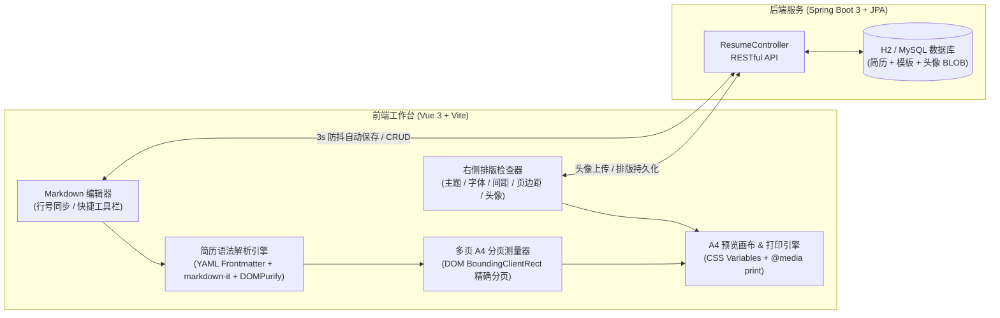

<div align="center">

# 📄 MarkResume

**基于 Spring Boot 3 + Vue 3 的企业级 Markdown 实时简历渲染与排版工作台**

[](https://spring.io/projects/spring-boot)
[](https://openjdk.org/)
[](https://vuejs.org/)
[](https://vitejs.dev/)
[](LICENSE)

<p align="center">
  左侧编写结构化 Markdown · 中间画布毫秒级渲染多页标准 A4 简历 · 右侧检查器像素级微调排版<br/>
  支持三列/两列对齐网格、头像自由拖拽、3 秒防抖自动保存、AI STAR 法则润色与矢量高清 PDF 导出
</p>

</div>

---

## ✨ 项目亮点

* 🖥️ **企业级三栏式 SaaS 工作台**：顶栏文档流控制 + 左侧 **CodeMirror 6** 专业编辑器 + 中间可缩放（`30% ~ 200%`）A4 点阵画布 + 右侧可折叠排版属性检查器（Inspector），默认清爽白天模式，支持一键切换深色模式。
* ⌨️ **CodeMirror 6 编辑器内核与智能补全**：
  * **Markdown + 简历扩展语法高亮**：针对标题、加粗、技能标签、YAML 头部键值、`::: row / cols-*` 容器块及 `---page---` 分页符进行专属语法着色。
  * **章节与容器代码折叠**：支持一键折叠 YAML 头部、任意 `H1~H6` 简历章节以及 `::: row / cols-*` 自定义块。
  * **Slash Command (`/`) & `:::` 智能自动补全**：在行首输入 `/`（如 `/row`、`/star`、`/cols3`、`/edu`、`/work`、`/page`）或 `:::` 即可弹出可视化指令菜单并自动定位光标。
* 🎯 **预览区反向点击定位（Click-to-Source）**：右侧 A4 简历画布中的姓名、联系方式、章节标题、同行经历与每一条列表项均精确绑定源码行号（`data-line`）；点击右侧任意段落，左侧编辑器自动展开折叠、平滑滚动居中并高亮闪烁对应源码行。
* 📐 **简历专属 Markdown 语法扩展**：
  * **YAML 头部元数据**：自动解析姓名、求职岗位、性别、出生年月、政治面貌、电话、邮箱、地址、学历、GitHub、个人主页，自动匹配 SVG 矢量图标并支持**三列 / 两列 / 单列 / 流式**切换。
  * **同行两端对齐 (`::: row`)**：一行语法搞定 `公司/学校名称（左） | 部门与职位（中） | 在职时间（右）`。
  * **多列严格左对齐网格 (`::: cols-3` / `cols-2` / `cols-1`)**：正文任意位置创建多行多列对齐属性表。
  * **技能胶囊标签**：行内反引号 `` `Spring Boot 3` `` 自动渲染为主题色胶囊标签（兼容中文全角反引号）。
* 📄 **真实多页 A4 智能分页 + 手动分页符**：
  * 基于浏览器真实 DOM 坐标差（精确计入 CSS 外边距折叠）自动拆分为多张独立 A4 纸，内置**防标题孤行**与**长列表跨页平滑拆分**。
  * 支持输入 `---page---` 手动强制换页，提供页码导航与底部页码开关。
* 🎨 **像素级排版控制**：内置 3 套主题风格、任意主题色、4 套中英文字体、字号、行高、模块间距、条目间距以及独立**上边距（`1px~52px`）、下边距（`1px~52px`）、左右边距**滑块，并提供「紧凑一页 / 标准 / 宽松」快捷预设。
* 🖼️ **头像/证件照双存储与自由拖拽**：上传头像同时存入后端数据库 `BLOB` 字段与本地目录；支持圆形、圆角方形、一寸证件照（3:4）切换与尺寸缩放（`52px~120px`）；在预览画布中**按住鼠标左键即可自由拖拽头像位置**，双击一键复位。
* 💾 **3 秒防抖自动保存 + 离线容灾**：编辑停顿 3 秒自动静默同步至后端数据库，同时实时备份至浏览器 `LocalStorage`，支持一键克隆副本与导入 `.md` 文件。
* 📤 **统一「导出」下拉菜单**：顶栏一个按钮集中提供
  * **PDF 文档**：直接下载 300DPI 高清 A4 PDF，邮箱 / GitHub / 主页超链接保持可点击，无需经过浏览器打印框；
  * **高清图片（PNG）**：300DPI 简历图，多页自动纵向拼接为长图，便于微信 / Boss 直聘发送；
  * **Markdown 源码（.md）**：纯文本备份；
  * **系统矢量打印**（`Ctrl + P`）：调用浏览器原生打印，作为 PDF 直出失败时的自动降级方案。
  文件名均自动使用当前简历标题。

---

## 🏗️ 系统架构



---

## 🛠️ 技术栈

| 模块 | 技术选型 | 说明 |
| :--- | :--- | :--- |
| **前端框架** | Vue 3.4 (Composition API) + Vite 5 | 响应式三栏工作台、组件化设计 |
| **编辑器内核** | CodeMirror 6 (`@codemirror/*`) | Markdown 语法高亮、章节代码折叠、`/` 与 `:::` 智能补全、反向定位高亮 |
| **解析与安全** | `markdown-it` + `DOMPurify` | 自定义块级语法扩展、精确源码行号映射（`lineMap`）、XSS 防护 |
| **PDF 导出引擎** | `jspdf` + `html-to-image` + `@media print` | 300DPI 离屏一键直出下载 PDF（叠加超链接热区）+ 原生矢量打印双模式 |
| **图标与样式** | `lucide-vue-next` + CSS Variables | 统一 Design Tokens、明暗双主题、原生打印样式表 |
| **后端框架** | Spring Boot 3.2.5 + Java 17 | RESTful 接口、Multipart 文件上传、AI 润色接口 |
| **数据存储** | Spring Data JPA + H2 Database | 本地文件持久化（`./data/resumedb`），零外部数据库依赖即可运行 |

---

## 📂 目录结构

```text
ResumePreview/
├── .gitignore                        # Git 忽略规则（排除 target、node_modules、本地库与上传文件）
├── README.md                         # 项目文档
├── backend/                          # Spring Boot 3 后端工程
│   ├── pom.xml
│   └── src/main/
│       ├── java/com/resume/
│       │   ├── ResumeApplication.java          # Spring Boot 启动类
│       │   ├── config/
│       │   │   ├── CorsConfig.java             # 全局跨域配置
│       │   │   ├── WebMvcConfig.java           # 上传文件静态资源映射
│       │   │   └── DataInitializer.java        # 内置 3 套简历模板与初始数据同步器
│       │   ├── controller/
│       │   │   └── ResumeController.java       # 简历 CRUD、模板库、头像上传读取、AI 润色接口
│       │   ├── entity/
│       │   │   ├── Resume.java                 # 简历主实体（含排版、边距、字体等字段）
│       │   │   ├── ResumeTemplate.java         # 预设简历模板实体
│       │   │   └── AvatarImage.java            # 头像二进制 BLOB 存储实体
│       │   └── repository/                     # Spring Data JPA 持久层接口
│       └── resources/
│           └── application.yml                 # 服务端口(8080)与 H2 数据库配置
└── frontend/                         # Vue 3 + Vite 前端工程
    ├── package.json
    ├── vite.config.js                # 开发服务器与 /api、/uploads 代理配置
    └── src/
        ├── main.js                   # 前端应用入口
        ├── App.vue                   # 三栏式主工作台与核心交互逻辑
        ├── api/
        │   └── resume.js             # Axios 请求封装
        ├── components/
        │   ├── MarkdownEditor.vue    # CodeMirror 6 编辑器组件（高亮/折叠/智能补全/行闪烁定位）
        │   ├── SettingSlider.vue     # 复合数值滑块组件
        │   └── SegmentedControl.vue  # 分段切换控制器组件
        ├── utils/
        │   ├── markdownParser.js     # 简历专用 Markdown 解析与 YAML 双向同步工具
        │   └── pdfExporter.js        # 300DPI 离屏一键直出下载 PDF 与矢量打印引擎
        └── styles/
            ├── main.css              # 样式入口
            ├── app.css               # 工作台外壳 Design Tokens 与组件样式
            └── resume.css            # A4 纸张、H1~H6、主题变体与 @media print 样式
```

---

## 🚀 快速开始

### 1. 环境准备
* **Java**：JDK 17 或更高版本
* **Maven**：3.8+
* **Node.js**：18.0+（推荐 Node 20 / 22 LTS）

### 2. 克隆仓库
```bash
git clone https://github.com/your-username/ResumePreview.git
cd ResumePreview
```

### 3. 启动后端 (Spring Boot)
```bash
cd backend
mvn spring-boot:run
```
> 后端默认监听 `http://localhost:8080`，H2 数据库文件会自动创建于 `backend/data/resumedb`，开箱即用无需额外配置数据库。

### 4. 启动前端 (Vue 3 + Vite)
打开一个新终端窗口：
```bash
cd frontend
npm install
npm run dev
```
> 浏览器访问 **[http://localhost:5173](http://localhost:5173)** 即可开始使用。

### 5. 生产环境构建
```bash
# 构建前端静态资源 (输出至 frontend/dist)
cd frontend && npm run build

# 打包后端可执行 JAR (输出至 backend/target)
cd ../backend && mvn clean package -DskipTests
```

---

## 📖 简历专用 Markdown 语法手册

### 1. 顶部个人信息栏（YAML Frontmatter）
在文档最顶部使用 `---` 定义个人信息，支持中英文键名及任意自定义字段：

```markdown
---
name: 林远 (Lin Yuan)
role: 高级 Java 后端开发工程师 · 4年经验
headerCols: cols-3
gender: 男
birthday: 1999.08
politics: 中共预备党员
phone: 138-0013-8000
email: linyuan.dev@example.com
location: 浙江杭州
education: 浙江大学 · 硕士
github: github.com/linyuan-dev
blog: tech.linyuan.dev
avatar: https://api.dicebear.com/7.x/notionists/svg?seed=Felix&backgroundColor=dbeafe
avatarShape: circle
avatarSize: 76
---
```

### 2. 经历同行左中右对齐（`::: row`）
```markdown
::: row
**字节跳动 (ByteDance)** | 电商交易研发部 · 高级后端开发工程师 | 2023.04 - 至今
:::
- **高并发履约核心链路重构**：主导订单履约与库存预占服务拆分，引入 `Caffeine + Redis` 二级缓存，峰值 QPS 突破 **65,000+**。
```

### 3. 多列上下严格左对齐网格（`::: cols-3` / `::: cols-2` / `::: cols-1`）
支持使用竖线 `|` 或中文逗号 `，` 分隔各列，跨行自动垂直对齐：

```markdown
::: cols-3
**电话**：138-0013-8000 | **邮箱**：linyuan@example.com | **地址**：浙江杭州
**性别**：男 | **出生年月**：1999.08 | **政治面貌**：中共预备党员
:::

::: cols-2
**主修课程**：数据结构、操作系统 | **英语水平**：CET-6 (615分)
**平均绩点**：3.88 / 4.0 (前5%) | **荣誉奖项**：国家奖学金
:::
```

### 4. 手动分页符（`---page---`）
```markdown
---page---
```

---

## 🔌 REST API 接口一览

| 方法 | 路径 | 说明 |
| :--- | :--- | :--- |
| `GET` | `/api/resumes` | 获取所有简历列表（按更新时间倒序） |
| `GET` | `/api/resumes/{id}` | 获取指定 ID 的简历详情 |
| `POST` | `/api/resumes` | 创建新简历或复制简历副本 |
| `PUT` | `/api/resumes/{id}` | 更新简历内容与排版设置 |
| `DELETE` | `/api/resumes/{id}` | 删除指定简历 |
| `GET` | `/api/templates` | 获取预设简历模板库列表 |
| `POST` | `/api/upload/avatar` | 上传头像图片（双写数据库 BLOB 与本地磁盘） |
| `GET` | `/api/upload/avatar/{filename}` | 获取头像图片二进制流 |
| `POST` | `/api/ai/polish` | AI STAR 法则一键润色简历描述 |

---

## 🗺️ Roadmap

- [x] 左右分栏实时 Markdown 解析与预览
- [x] 企业级三栏式 SaaS 工作台与右侧可折叠属性检查器
- [x] 自定义 `::: row`、`::: cols-3 / cols-2 / cols-1` 语法与 YAML 头部解析
- [x] 真实多页 A4 自动分页、防标题孤行与手动分页符 (`---page---`)
- [x] 头像上传入库、形状/尺寸调节与画布内鼠标自由拖拽
- [x] 编辑停顿 3 秒防抖自动保存（Auto-Save）与离线容灾
- [x] 导入 `.md`、一键克隆副本
- [x] 统一导出菜单：高清 PDF 直出（保留超链接）、高清 PNG 图片、Markdown 源码、系统矢量打印
- [x] 升级 CodeMirror 6 编辑器内核（语法高亮、章节折叠、`/` 与 `:::` 智能补全）
- [x] 预览区反向点击定位源码（Click-to-Source 双向行级联动）
- [ ] 数据库平滑切换至 MySQL 8 / PostgreSQL + Flyway 版本迁移
- [ ] 接入 Spring AI / DeepSeek / 通义千问真实大模型流式润色与 JD 匹配度评测
- [ ] 简历历史版本快照对比与一键回滚

---

## 📄 License

本项目基于 [MIT License](LICENSE) 开源。
